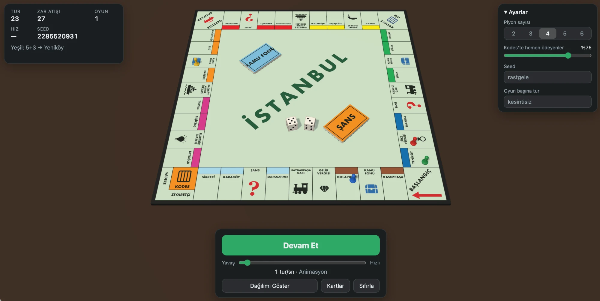
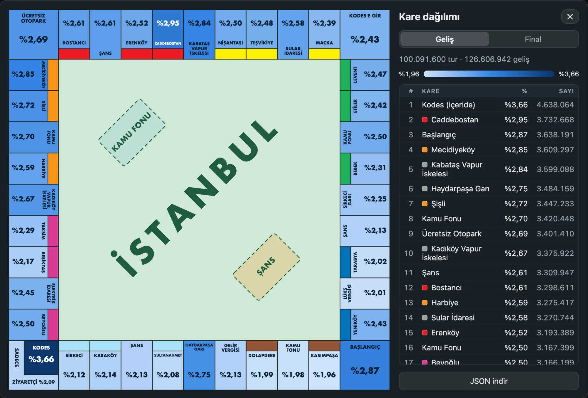
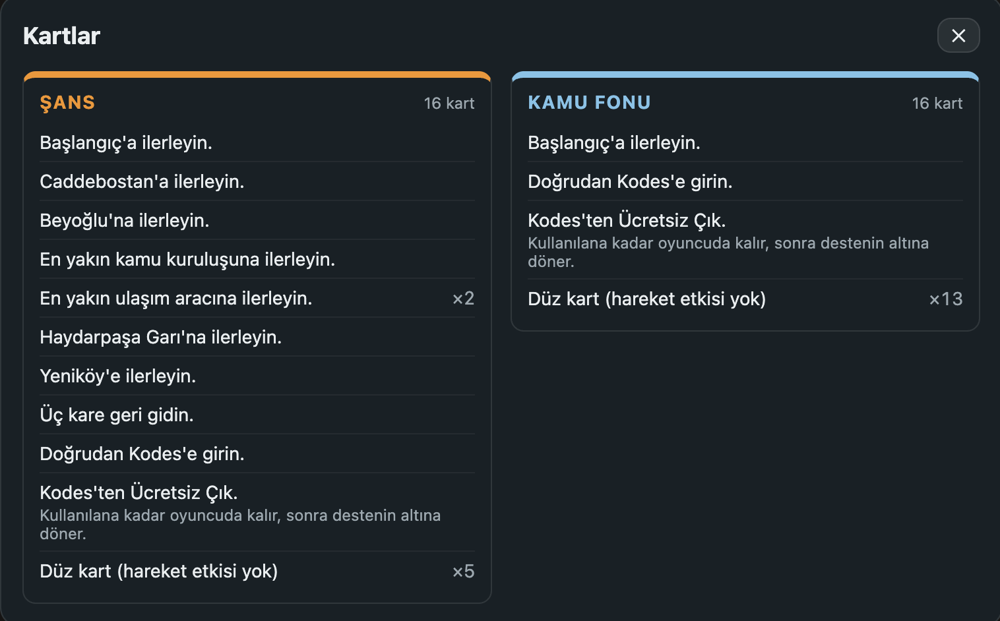

# monopoly

**How often does a pawn land on each square of Monopoly?** A seeded Monte Carlo engine
that plays the İstanbul edition turn by turn, with a 3D board to watch it happen and a
heatmap of where the pawns end up.

**▶ Live: [monopoly.mubatu.com](https://monopoly.mubatu.com)**



- **Every movement rule.** Doubles and re-rolls, jail on three doubles, Go to Jail, the
  ways out of jail, and real Chance / Community Chest decks.
- **Watch or crunch.** From half a turn per second with animated dice and hopping
  pawns, up to a million turns per second in turbo mode.
- **Reproducible.** The same seed gives the same numbers in the browser and on the
  command line.
- **No server.** Everything runs in the browser; the site is plain static files.

## Results: 100 million turns



If every square were equally likely, each would get about 2.4% of the landings. After
100,091,600 turns they don't:

- **Jail is the busiest place on the board** (3.66%): Go to Jail, three doubles and
  the jail cards all send pawns there.
- **Next come squares a couple of rolls past Jail, and card targets.** Caddebostan
  (2.95%) is the most visited property, followed by Başlangıç (2.87%), Mecidiyeköy
  (2.85%) and Kabataş Vapur İskelesi (2.84%). Pawns leaving Jail pass this stretch
  often, and cards send pawns straight to Caddebostan, Başlangıç and the nearest
  station.
- **The first side is the quietest.** Kasımpaşa (1.96%), the first Kamu Fonu (1.98%)
  and Dolapdere (1.99%) are the least visited squares on the board.

The view can switch between **Geliş** (every stop, including ones a card moves the pawn
away from) and **Final** (where each roll ends); see
[What is counted, and how](#what-is-counted-and-how).

## The cards are part of the simulation



Cards are not modelled as fixed probabilities: each game shuffles both 16-card decks,
cards are drawn from the top and go back to the bottom, and a "Get Out of Jail Free"
card stays with the player until it is used. 10 of the 16 Chance cards move the pawn;
in Community Chest only 2 do. The **Kartlar** button in the app lists both decks.

## About

The system only rolls dice and moves: there is no property, rent, money or houses/hotels.
Every rule that affects movement is implemented: rolling again on doubles, jail on three
doubles in a row, the Go to Jail square, the rules for getting out of jail, and Chance /
Community Chest cards that are actually drawn (shuffled deck, a drawn card goes back to
the bottom, the "Get Out of Jail Free" card stays with the player).

## Setup

Requires Node 22 or later.

```bash
npm install
```

```bash
npm test
```

The engine has no runtime dependencies; apart from `cli.ts`, nothing under `src/` uses
`fs`, `process` or `console`, so it also runs in the browser. The only runtime
dependency, `three`, is used solely by the visualization under `web/`.

## Usage

```bash
npx tsx src/cli.ts --players 4 --games 1000 --turns 1000 --jail-pay 0.6 --seed 42 --out results/run1.json
```

The tool writes the result as JSON and prints a table sorted by `finalPct`, a jail
summary and group totals to the terminal.

| Option | Default | Description |
|--------|---------|-------------|
| `--players <n>` | `4` | Number of pawns, 2–6. |
| `--games <n>` | `100` | Number of games. Each game starts with freshly shuffled decks and all pawns on Go. |
| `--turns <n>` | `1000` | Turns **per player** in each game. Total turns = `players × games × turns`. |
| `--jail-pay <p>` | `0.5` | 0–1. On every jail entry the "pay immediately" strategy is chosen with this probability; otherwise the player tries to roll a double. |
| `--seed <n>` | random | 32-bit integer. The same seed with the same parameters gives exactly the same result. |
| `--edition <name>` | `istanbul` | Board/card data. Only `istanbul` for now. |
| `--per-game` | off | Also writes per-game final counts to the JSON (for variance analysis). |
| `--out <file>` | `results/<time>-<seed>.json` | JSON output path. The timestamp is in UTC. |
| `--help` | | Help. |

Options can be written as `--games 100` or `--games=100`. On an invalid value the tool
prints an explanatory error and exits with code 1. (The CLI's messages are in Turkish.)

Other commands: `npm run sim -- <options>` (CLI shortcut), `npm run typecheck`
(engine + web), `npm run build` (compiles the engine to `dist/`).

## Visualization

A 3D interface that runs in the browser: board, pawns, dice and card decks; a
Start/Stop button and a speed slider at the bottom; a distribution view that updates
live. It drives the engine directly, so with the same seed its numbers are exactly the
ones the CLI produces. The interface is in Turkish.

```bash
npm run dev
```

Open the address Vite prints (by default `http://localhost:5173`) in a browser.
`npm run build:web` makes a static build (output in `dist-web/`); `npm run preview`
serves the built version.

### Controls

- **Başlat / Durdur / Devam Et** (Start / Stop / Resume): the big button at the bottom;
  the `Space` key does the same. On stop the move in progress finishes its animation and
  no new turn starts.
- **Speed slider**: 0.5 – 1,000,000 turns/s, logarithmic. A "turn" is one player's go.
- **Dağılımı Göster** (Show distribution): a heatmap of the board seen from above (see
  below). `Esc` closes it.
- **Kartlar** (Cards): the contents of the Chance and Community Chest decks; identical
  cards are listed once with their count. `Esc` closes it.
- **Sıfırla** (Reset): puts counters and pawns back to the start and applies the values
  in the settings panel.
- **Ayarlar** (Settings, top right): number of pawns (2–6), share of players who pay
  immediately in jail, seed (picked at random when empty and shown at the top left),
  turns per game (when empty a single game runs without end). Before any turn has been
  played a change takes effect immediately; once there is run data it is applied with
  **Uygula ve Sıfırla** (Apply and reset). Settings are locked while the simulation runs.
- Drag with the mouse to rotate the camera, use the wheel to zoom.

### Speed regimes

| Regime | Speed | What you see |
|--------|-------|--------------|
| Animated | ≤ 10 turns/s | The dice roll, the pawn hops square by square, the drawn card is shown. Moving forward by card and going to jail play as a single high arc; "go back 3 squares" hops backwards. |
| Quick | 10–60 turns/s | The dice values appear directly; the pawn slides in one move to the square where the turn ends. |
| Turbo | > 60 turns/s | No animation; pawns jump to their current position every frame. "Hız" (Speed) at the top left shows the measured speed, not the target. |

Pawns in jail stand inside the cell; visitors stand on the outer strip of the corner. A
pawn holding a "Get Out of Jail Free" card has a small card next to it.

### Distribution view

Each square is coloured by the selected counter (**Geliş** = landings, or **Final**) and
its percentage is written on it; in the jail corner the cell (jail entries) and the outer
strip (Just Visiting) are separate. The colour scale spans the lowest to the highest value
in the data (the legend shows both); squares differ by only a percentage point or two, so
on a scale starting at zero they would all look the same shade. Beside the board there is
a table of squares sorted by percentage and the group totals; hovering a square shows its
landing and final counts together. It refreshes a few times a second while the simulation
runs. **JSON indir** (Download JSON) saves the current result, in the same format as the CLI.

In endless mode, once `N` full rounds (each player `N` times) have been played in the
interface, the result equals the one produced by `npx tsx src/cli.ts --games 1 --turns N`
with the same seed and settings.

### Deployment

The site is hosted on Cloudflare Pages, connected to this GitHub repository; every push
to `main` is built and published. The project settings are:

```txt
Build command: npm run build:web
Build output directory: dist-web
Root directory: /
```

## What is counted, and how

- **Landings (Geliş)**: every stop of a pawn on a square, including intermediate
  ones. Landing on Chance and drawing "advance to Yeniköy" increments both the Chance and
  the Yeniköy counters.
- **Finals (Final)**: where a dice roll ends after cards are resolved. Each roll
  produces at most one final; the extra roll earned with a double is a separate final.
- **Jail**: square 10 counts only "Just Visiting" landings. Jail entries are counted
  separately and count as the final of the roll that sent the pawn there. Landing on Go
  to Jail counts as a landing there, but never as a final.
- **Turns spent in jail**: turns in which the player failed to roll
  a double and stayed inside. These are not landings on a square.
- **Getting out of jail**: a player holding a "Get Out of Jail Free" card uses it on the
  first turn (with two cards, the Chance one first). Otherwise the strategy chosen on
  entry applies: "pay" → gets out on the first turn and plays a normal turn (rolls again
  on a double); "roll" → on a double gets out with that roll and does not roll again; on
  the third failed roll pays and moves with that same roll.

## Data sources

**Board.** Monopoly İstanbul (the classic edition with neighbourhood names). Square names
and colour groups are based on World of Monopoly's Turkey page (Hasbro standard ref. 0695,
1995 listing), Wikipedia's "List of licensed and localized editions of Monopoly: Europe"
page and colour-group listings in dictionaries. Corner and special square names
(Başlangıç, Kodes, Ücretsiz Otopark, Kodes'e Gir, Şans, Kamu Fonu) come from Hasbro's 2010
Turkish rulebook. Square 23 was confirmed as **Erenköy** by the user. The layout is the
standard Monopoly layout.

**Cards.** The exact text of the Turkish cards could not be found online. The movement
cards are the İstanbul-board equivalents of Hasbro's international standard set; the
presence of "advance to the nearest station" (×2) and "advance to the nearest utility" in
the Chance deck was confirmed by the user from the deck in the box. Cards without a
movement effect do not affect the simulation, so they appear in the data file as "Düz
kart" (plain card); only their count matters (5 in Chance, 13 in Community Chest).

To add another edition, put new board and card files under `data/` and add the edition to
the lists in `src/board.ts`, `src/cards.ts` and `src/types.ts`; the data is validated on
load.

---

Everything on the board is drawn in code; no Hasbro logos, mascots or artwork are used.
Monopoly is a trademark of Hasbro; this is an independent project, not affiliated with or
endorsed by Hasbro.
